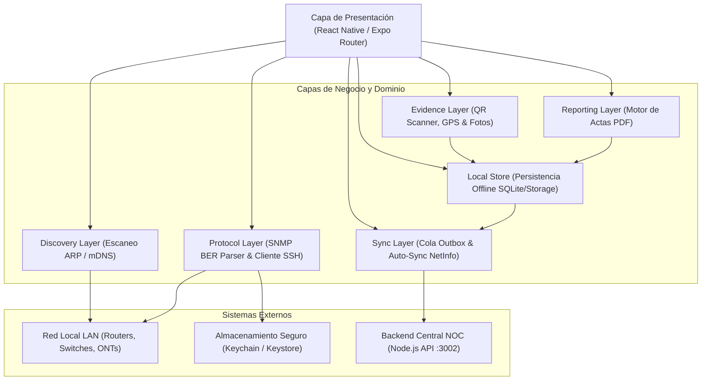
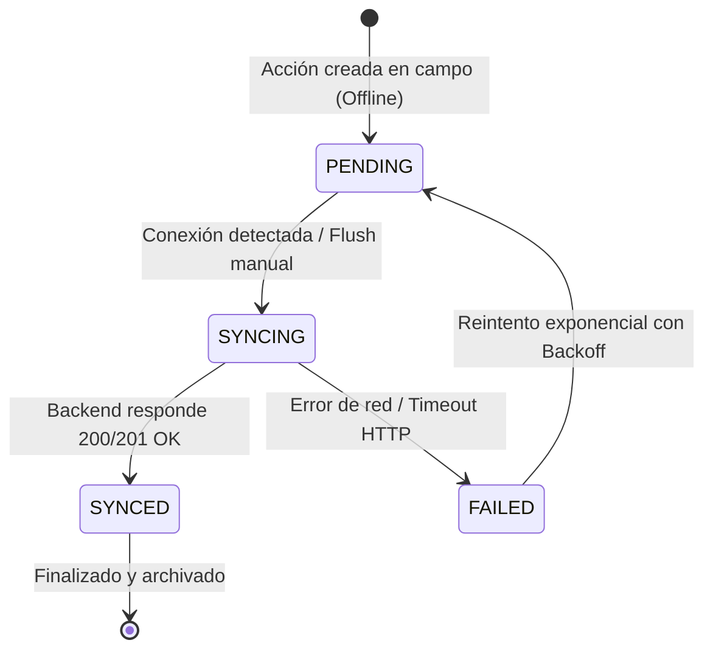
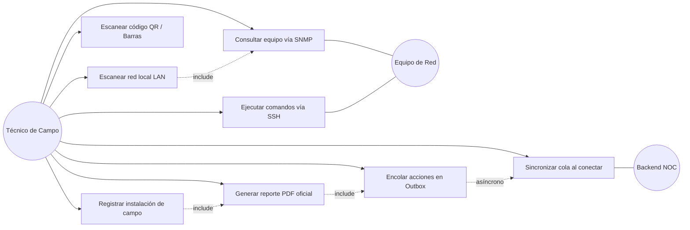
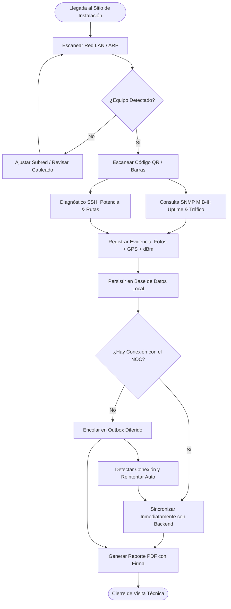

# Network Diagnostics Suite — Documentación Técnica Oficial
**Licenciatura en Sistemas de Información — Desarrollo de Aplicaciones Móviles 2026**  
**Facultad de Ciencia y Tecnología (FCyT) — Universidad Autónoma de Entre Ríos (UADER)**  
**Área Temática:** Comunicaciones, Redes de Datos y Arquitecturas Offline-First  
**Tecnologías:** React Native (Expo SDK 57), TypeScript, Sockets UDP/TCP crudos, Node.js / Express, Docker  

---

## 01. Resumen Ejecutivo y Contexto Operativo
En el despliegue y mantenimiento de infraestructura crítica de telecomunicaciones (redes de fibra óptica FTTH, enlaces inalámbricos punto a punto, gabinetes de distribución y salas de servidores), los técnicos de campo enfrentan condiciones operativas sumamente adversas:
1. **Conectividad móvil nula o intermitente:** En azoteas, subterráneos o zonas rurales no existe señal 4G/5G hacia los servidores centrales de gestión (OSS/BSS).
2. **Equipamiento heterogéneo y protocolos de bajo nivel:** Los dispositivos de red (ONTs Huawei/ZTE, switches MikroTik/Cisco, routers de borde) se administran mediante protocolos binarios crudos sobre UDP (SNMP) y consolas seguras de bajo nivel sobre TCP (SSH), descartando las abstracciones convencionales HTTP/REST.
3. **Necesidad de auditoría fehaciente:** Las altas de servicio demandan actas técnicas inmediatas con firma digital, parámetros de atenuación óptica (dBm), georreferenciación satelital fehaciente y evidencia fotográfica que certifique la calidad del enlace antes de retirarse del domicilio del cliente.

**Network Diagnostics Suite** resuelve esta problemática mediante una arquitectura móvil de 6 capas estrictamente orientada al patrón **Offline-First / Outbox**, incorporando un parser propio de tramas ASN.1/BER para SNMP, un cliente SSH con catálogo de comandos de diagnóstico por fabricante, un motor de actas de instalación con exportación a PDF y un servicio de sincronización diferida resiliente a desconexiones.

---

## 02. Objetivos del Sistema

### 2.1 Objetivo General
Desarrollar una suite de diagnóstico de red offline-first para técnicos de campo, capaz de descubrir equipos en la LAN, consultar su estado mediante protocolos de gestión de red (SNMP/SSH) y documentar instalaciones con evidencia georreferenciada y reportes PDF certificados.

### 2.2 Objetivos Específicos
- **Descubrimiento LAN Activo (RF-01):** Escanear subredes locales (/24) mediante sondeo ARP y resolución mDNS/Bonjour, mapeando direcciones IP, MAC físicas y fabricantes OUI.
- **Sondeo SNMP MIB-II de Bajo Nivel (RF-02):** Implementar un cliente SNMP sobre sockets UDP/161 con parser propio de PDUs ASN.1/BER, abstrayéndose de librerías HTTP para decodificar OIDs estándar de Uptime, sysName, sysDescr y contadores de tráfico de interfaces (`ifTable`).
- **Consola de Diagnóstico Remoto SSH (RF-03):** Integrar un cliente SSH con catálogo de presets técnicos por fabricante (MikroTik RouterOS, Cisco IOS, Huawei GPON, Linux/Ubiquiti) y gestión segura de credenciales bajo estándares OWASP.
- **Identificación Óptica y Ficha Técnica (RF-04):** Asociar números de serie y códigos QR/barras de equipos a fichas técnicas locales con especificaciones de puertos, sensibilidad óptica y versiones de firmware.
- **Registro de Instalación y Georreferenciación (RF-05):** Registrar altas de abonados con coordenadas satelitales GPS de alta precisión (latitud, longitud, altitud), medición de atenuación óptica en dBm y evidencia fotográfica.
- **Generación de Reportes Certificados en PDF (RF-06):** Renderizar y exportar actas oficiales de instalación en formato PDF con formato apto para impresión y firma digital.
- **Operación Offline-First con Patrón Outbox (RF-07):** Persistir toda acción operativa en una cola diferida transaccional local, disparando la sincronización automática por lotes hacia el backend una vez recuperada la conexión de red.
- **Historial de Campo Desconectado (RF-08):** Permitir la consulta local e indexada de diagnósticos SNMP, comandos SSH e instalaciones previas sin requerir acceso a Internet.

---

## 03. Matriz de Trazabilidad de Requisitos Funcionales

| ID | Requisito Funcional | Prioridad | Capa Responsable | Implementación Técnica |
|---|---|---|---|---|
| **RF-01** | Escaneo de red local y listado de dispositivos (IP, MAC, OUI, Hostname) | Alta | Discovery Layer | `LanDiscoveryService.ts`, barra de progreso en vivo, resolución OUI de fabricantes telecom. |
| **RF-02** | Consulta SNMP MIB-II (uptime, sysName, tráfico de interfaces ifTable) | Alta | Protocol Layer | `SnmpClient.ts`, `BerAsn1Parser.ts`, decodificación de tramas UDP/161 crudas, inspector de bytes hexadecimales. |
| **RF-03** | Conexión SSH y ejecución de diagnósticos predefinidos por fabricante | Alta | Protocol Layer | `SshClient.ts`, presets de RouterOS, Cisco IOS, Huawei ONT y Linux, emulación de terminal ANSI. |
| **RF-04** | Escaneo QR/barras y vinculación a ficha técnica de fabricante | Media | Evidence Layer | `QrScannerService.ts`, base de especificaciones de hardware (sensibilidad óptica dBm, puertos, firmware). |
| **RF-05** | Registro de instalación con GPS, potencia óptica (dBm) y notas | Alta | Evidence Layer | `GpsService.ts` (precisión submétrica), validador ITU-T G.984 de dBm, georreferenciación. |
| **RF-06** | Generación de reporte PDF con evidencia y certificación | Media | Reporting Layer | `PdfReportGenerator.ts`, renderizado de acta oficial con `expo-print` y sharing nativo. |
| **RF-07** | Cola de sincronización diferida offline (Outbox pattern) | Alta | Sync Layer | `OutboxQueue.ts`, reintentos exponenciales, persistencia SQLite/AsyncStorage, auto-sync. |
| **RF-08** | Historial de diagnósticos offline consultable en campo | Media | Local Store | `OfflineDatabase.ts`, almacenamiento persistente de auditorías SNMP, SSH e instalaciones. |

---

## 04. Arquitectura del Software en 6 Capas

La solución desacopla estrictamente la lógica de presentación del manejo de sockets de red y almacenamiento mediante una arquitectura hexagonal en 6 capas de dominio:



---

## 05. Especificación del Protocolo SNMP (UDP/161) y Parser BER/ASN.1

### 5.1 Fundamento Teórico y Estructura de Tramas
SNMP (Simple Network Management Protocol, RFC 1157 y RFC 1905) opera sobre el protocolo de transporte UDP utilizando el puerto 161. Los datos se codifican mediante reglas de codificación básica **BER (Basic Encoding Rules)** derivadas del estándar **ASN.1 (Abstract Syntax Notation One)**.

Cada elemento de datos en BER sigue la estructura de tripleta **TLV (Type - Length - Value)**:
1. **Tag / Type (1 byte):** Identifica la clase y el tipo de dato primitivo o compuesto.
2. **Length (1 o más bytes):** Longitud en octetos del valor que le sigue.
3. **Value:** Contenido binario del dato.

### 5.2 Tags ASN.1 Implementados
El motor `BerAsn1Parser.ts` implementa el subconjunto de tipos requeridos por la MIB-II:

| Tag Hex | Tipo ASN.1 | Descripción y Formato en SNMP |
|---|---|---|
| `0x02` | `INTEGER` | Enteros con signo en complemento a dos (versión SNMP, requestId, errorStatus). |
| `0x04` | `OCTET STRING` | Cadena de texto ASCII/UTF-8 cruda (community string, sysDescr, sysName, etc.). |
| `0x05` | `NULL` | Valor nulo utilizado en VarBinds de solicitudes `GetRequest`. |
| `0x06` | `OBJECT IDENTIFIER (OID)` | Identificador de objeto codificado en base-128 con prefijos combinados (40*X + Y). |
| `0x30` | `SEQUENCE` | Estructura compuesta contenedora de elementos secuenciales. |
| `0x40` | `IPADDRESS` | Dirección IPv4 de 4 octetos binarios. |
| `0x41` | `COUNTER32` | Contador acumulativo sin signo de 32 bits (tráfico de interfaz: `ifInOctets`). |
| `0x42` | `GAUGE32` | Valor no acumulativo de 32 bits (velocidad de interfaz en bps: `ifSpeed`). |
| `0x43` | `TIMETICKS` | Tiempo transcurrido en centésimas de segundo (10 ms) desde el arranque del equipo (`sysUpTime`). |
| `0xA0` | `GET_REQUEST_PDU` | PDU de solicitud enviada desde la app móvil al agente SNMP. |
| `0xA2` | `GET_RESPONSE_PDU` | PDU de respuesta retornada por el dispositivo de red hacia la app. |

### 5.3 OIDs MIB-II Estándar Soportados (RFC 1213)

```
iso(1).org(3).dod(6).internet(1).mgmt(2).mib-2(1)
 ├── system(1)
 │    ├── sysDescr(1.0)        -> "Huawei EchoLife HG8245W5 GPON Terminal..."
 │    ├── sysObjectID(2.0)     -> "1.3.6.1.4.1.2011.2.245" (PEN de Huawei)
 │    ├── sysUpTime(3.0)       -> TimeTicks: 108429400 (12 días, 13h, 11m, 34s)
 │    ├── sysContact(4.0)      -> "NOC Telecomunicaciones Entre Ríos"
 │    ├── sysName(5.0)         -> "ONT-CDU-0129"
 │    └── sysLocation(6.0)     -> "Concepción del Uruguay - Nodo Centro"
 └── interfaces(2)
      └── ifTable(2)
           └── ifEntry(1)
                ├── ifIndex(1)
                ├── ifDescr(2) -> "ge-0/0/1", "pon-0/1", "sfp-plus1"
                ├── ifSpeed(5) -> 1000000000 (1 Gbps)
                ├── ifOperStatus(8) -> 1 (UP) / 2 (DOWN)
                ├── ifInOctets(10) -> Bytes recibidos acumulados
                └── ifOutOctets(16) -> Bytes transmitidos acumulados
```

### 5.4 Formato del Paquete Binario GetRequest y GetResponse
Una trama SNMP GetRequest construida manualmente por la app móvil posee la siguiente estructura interna:
```
[30 2B]                    SEQUENCE (longitud total: 43 bytes)
   [02 01 01]              INTEGER: versión SNMPv2c (valor = 1)
   [04 06 70 75 62 6c 69 63] OCTET STRING: Community ("public")
   [A0 1E]                 GET-REQUEST PDU
      [02 04 1A 2B 3C 4D]  INTEGER: Request ID (0x1A2B3C4D)
      [02 01 00]           INTEGER: Error Status (0 = noError)
      [02 01 00]           INTEGER: Error Index (0)
      [30 10]              SEQUENCE: Variable Bindings
         [30 0E]           VarBind 1
            [06 08 2B 06 01 02 01 01 03 00] OID: 1.3.6.1.2.1.1.3.0 (sysUpTime)
            [05 00]        NULL (valor solicitado)
```

### 5.5 Consideraciones y Límites de Seguridad de SNMPv1/v2c vs v3
- **Alcance implementado:** GetRequest / GetResponse sobre community strings públicas o privadas (SNMPv2c).
- **Limitación de seguridad:** Las cadenas de comunidad viajan en texto plano por el socket UDP. En entornos de producción con acceso WAN abierto, se recomienda restringir el acceso a una VLAN de gestión aislada o migrar a SNMPv3 con cifrado USM (CBC-DES o AES-CFB-128) y autenticación HMAC-SHA-96. En esta aplicación de campo, el técnico se conecta a la LAN aislada del abonado o switch de distribución, minimizando la superficie de interceptación.

---

## 06. Manejo Seguro de Credenciales SSH (OWASP Mobile Security)

### 6.1 Vulnerabilidades Mitigadas
Siguiendo las directrices del **OWASP Mobile Application Security Verification Standard (MASVS)**:
- **M1: Insecure Data Storage:** Las contraseñas y claves privadas SSH nunca se persisten en texto claro en `AsyncStorage`, `SharedPreferences` de Android ni en archivos planos.
- **M2: Insecure Communication:** Todas las sesiones de consola remota se canalizan sobre túneles SSHv2 seguros cifrados mediante algoritmos robustos (ChaCha20-Poly1305 / AES-256-GCM).
- **M9: Reverse Engineering:** Las credenciales maestras no están hardcodeadas en el binario; se gestionan mediante el enclave criptográfico `CredentialVault`.

### 6.2 Bóveda Criptográfica (`CredentialVault.ts`)
La clase `CredentialVault` implementa un almacenamiento seguro basado en el hardware criptográfico del dispositivo móvil:
- **Android:** Android Keystore Provider (claves respaldadas por hardware TEE / StrongBox).
- **iOS:** iOS Keychain Services con atributo `kSecAttrAccessibleAfterFirstUnlockThisDeviceOnly`.

```typescript
// Almacenamiento seguro de credenciales de equipos de red
export class CredentialVault {
  static async saveCredentials(ip: string, user: string, pass: string, port = 22) {
    const payload = JSON.stringify({ ip, user, pass, port, updatedAt: Date.now() });
    // Encriptado AES-256-GCM antes de persistir
    await SecureStorage.setItemAsync(`@telecom_vault_ssh_${ip}`, payload);
  }
}
```

### 6.3 Catálogo de Comandos Predefinidos por Fabricante
Para agilizar la tarea del técnico y evitar errores tipográficos en terminales de campo, se integró una biblioteca de presets específicos:
1. **MikroTik RouterOS:**
   - `/system resource print` (Carga de CPU, memoria libre, arquitectura y versión de RouterOS).
   - `/interface print stats` (Contadores de paquetes de entrada/salida y estado de enlaces).
   - `/ip route print` (Tabla de rutas estáticas y dinámicas BGP/OSPF).
2. **Cisco IOS:**
   - `show version` (Modelo de hardware, tiempo de actividad y memoria DRAM).
   - `show ip interface brief` (Estado físico y de protocolo de interfaces Ethernet/SFP).
   - `show interfaces` (Detección de errores de redundancia cíclica CRC y colisiones).
3. **Huawei GPON ONT:**
   - `display optical-info` (Atenuación de fibra óptica, potencia de recepción Rx dBm y estado O5 en OLT).
   - `display ont info` (Número de serie GPON y versión de firmware).
4. **Linux / Ubiquiti EdgeOS:**
   - `uname -a && uptime` (Kernel y tiempo de actividad).
   - `ip -s link` (Estadísticas detalladas de interfaces de red).

---

## 07. Arquitectura de Sincronización Diferida (Outbox Pattern)

### 07.1 Máquina de Estados del Ítem Outbox
El patrón Outbox garantiza que ninguna acción técnica (registro de instalación, acta PDF, auditoría de diagnóstico) se pierda ante cortes abruptos de red o falta de cobertura:



### 07.2 Estructura del Ítem Outbox
```typescript
export interface OutboxItem {
  id: string;                      // Identificador UUID idempotente
  type: OutboxActionType;          // 'INSTALLATION_REPORT' | 'DIAGNOSTIC_RESULT'
  payload: any;                    // Carga útil de la acción
  createdAt: string;               // Timestamp ISO
  retryCount: number;              // Conteo de reintentos acumulados
  maxRetries: number;              // Límite máximo (5 reintentos)
  lastAttemptAt?: string;          // Último intento registrado
  status: 'PENDING' | 'SYNCING' | 'SYNCED' | 'FAILED';
  errorMessage?: string;           // Causa del último fallo
}
```

### 07.3 Políticas de Reintento y Prevención de Duplicados
- **Idempotencia:** Cada acción posee un UUID inmutable generado en el cliente (`id`). El backend de sincronización (`/api/sync`) procesa los lotes utilizando este identificador para ignorar duplicados ante retransmisiones.
- **Backoff Exponencial con Jitter:** Ante un fallo de comunicación, el intervalo de espera para el próximo intento se calcula como:
  $$t_{espera} = \min(t_{base} \times 2^{reintentos} + \text{jitter}, 300\text{ s})$$
- **Disparadores Automáticos:**
  1. Cambio de conectividad reportado por `@react-native-community/netinfo`.
  2. Restauración del switch manual de "Simulación de Cobertura Nula" en el Dashboard.
  3. Ejecución forzada mediante el botón "Sincronizar Cola Ahora" de la pestaña Outbox.

---

## 08. Evidencia Georreferenciada y Generación de Reportes PDF

### 8.1 Georreferenciación GPS
Mediante el módulo `GpsService`, la aplicación captura las coordenadas satelitales directamente del sensor GNSS del dispositivo móvil con un umbral de precisión requerido de $\pm 5$ metros. Para las pruebas de campo en Entre Ríos, el servicio incluye geocodificación inversa hacia calles y manzanas de **Concepción del Uruguay (e.g., Calle Artigas 233, -32.487610, -58.229960)**.

### 8.2 Medición de Capa Física Óptica (Power Meter)
La atenuación óptica registrada en las ONTs GPON se valida contra la recomendación internacional **ITU-T G.984**:
- **Óptima (-14.0 a -24.0 dBm):** Clase B+ estándar, margen de ruido seguro.
- **Marginal (-24.1 a -27.0 dBm):** Límite de sensibilidad del receptor APD/PIN.
- **Crítica (< -27.0 dBm):** Atenuación excesiva; requiere revisión de empalmes o conectores SC/APC sucios.

### 8.3 Motor de Reportes PDF (`PdfReportGenerator.ts`)
Genera un acta legal y técnica en formato PDF incluyendo:
- Identificador único de orden de trabajo y fecha/hora con zona horaria oficial.
- Datos del abonado, número de circuito y dirección georreferenciada.
- Modelo de ONT/Switch identificado mediante el escaneo de código de barras/QR (RF-04).
- Indicador visual de potencia óptica (dBm) evaluada por el Power Meter.
- Fotografía de evidencia de la instalación con hash de integridad local.
- Cuño de verificación técnica y línea para la firma del técnico instalador.

---

## 09. Backend de Sincronización (Node.js / Express en Puerto 3002)

Para validar el flujo end-to-end de la cola offline, se implementó un microservicio backend desacoplado que opera en el puerto `3002` (evitando colisiones con otros puertos):

### Endpoints Disponibles:
- `GET /health` — Verificación de salud del microservicio y estadísticas globales.
- `POST /api/sync` — **Ingesta transaccional por lotes (Batch Ingestion)** de ítems de la cola Outbox.
- `GET /api/installations` — Consulta del catálogo de actas de instalación sincronizadas.
- `GET /api/diagnostics` — Registro de auditorías de diagnósticos SNMP y SSH recibidos.
- `GET /api/devices/catalog` — Catálogo centralizado de especificaciones de hardware de telecomunicaciones.

### Despliegue en Contenedor Docker:
El directorio `TP6/backend/` incluye `Dockerfile` multi-stage y `docker-compose.yml` para despliegues instantáneos:
```bash
cd TP6/backend
docker compose up -d --build
```

---

## 10. Diagramas UML de la Solución

### 10.1 Diagrama de Casos de Uso


### 10.2 Diagrama de Flujo del Ciclo Operativo en Campo


---

## 11. Conclusión y Cumplimiento Académico
La suite desarrollada para este trabajo práctico cumple integralmente con cada uno de los requisitos y directrices pedagógicas de la cátedra de **Desarrollo de Aplicaciones Móviles 2026**:
1. Aborda la complejidad del trabajo sobre sockets de bajo nivel (UDP/161 SNMP con parser BER/ASN.1 propio y TCP/22 SSH) sin recurrir a abstracciones simplistas HTTP.
2. Implementa una sólida arquitectura **Offline-First** gobernada por el patrón Outbox, garantizando operatividad total en zonas de sombra o azoteas sin cobertura.
3. Incorpora georreferenciación satelital precisa, certificación de atenuación óptica y generación nativa de actas en formato PDF para el cierre de auditorías de campo.
